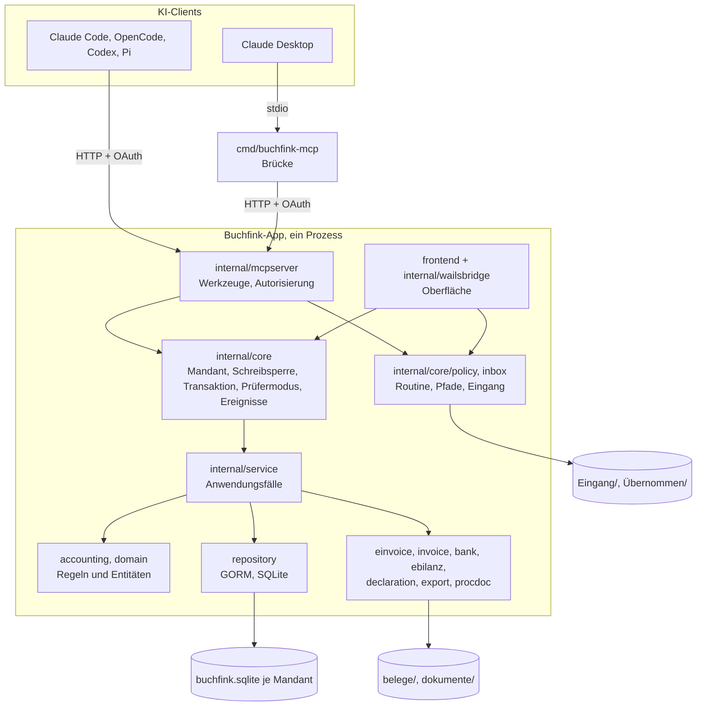
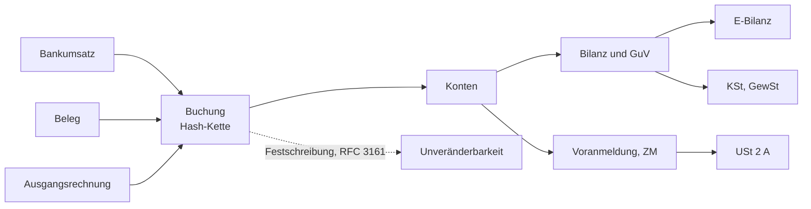

# Architektur

[Dokumentation](../README.md) · [Entwicklung](README.md) ·
[Orientierung im Code](codebase.md) · [MCP-Server](mcp.md)

Buchfink führt die Bücher einer GmbH oder UG. Ein KI-Agent bedient Buchfink über
MCP, der Mensch sieht in der App, was geschehen ist, und gibt frei, was sich
nicht rückgängig machen lässt. Diese Seite beschreibt, wie das gebaut ist und
warum.

## 1. Grundentscheidungen

| Entscheidung | Folge |
|---|---|
| **Ein Prozess, ein Schreiber.** Der MCP-Server läuft im Prozess der App. | Ohne geöffnete App keine Werkzeuge. Oberfläche und Agent schreiben über denselben Kern und dieselbe Sperre. |
| **Freigabe nach Risiko.** Routine bucht der Agent direkt nach festen Regeln, was sich per Storno korrigieren lässt nach Zustimmung im Chat, Unumkehrbares und Stammdaten nur der Mensch in der App. | Der Kern weist Vorgänge, die der App vorbehalten sind, für jeden anderen Erfassungsweg ab. Ein Werkzeug dafür gibt es nicht. Einzelne Konten sperrt Buchfink für Agenten nicht. |
| **Ablage auf Anweisung.** Belege, E-Rechnungen und Kontoauszüge kommen in einen Eingang je Mandant. | Buchfink beobachtet keinen Ordner und legt nichts von selbst ab. Der Agent legt ab, wenn der Mensch es sagt; danach verschiebt Buchfink die Datei in den Unterordner `Übernommen/`. |
| **Lokal und unverschlüsselt.** Alle Daten liegen im Datenordner des Mandanten. | Schutz am Rechner über das Betriebssystem, Integrität über Hash-Ketten und Zeitstempel ([Datensicherheit](../nutzung/datensicherheit.md)). |
| **Keine Übermittlung.** Buchfink sendet nichts an Finanzamt oder Register. | Voranmeldung und Erklärungen sind Eingabehilfen für Mein ELSTER. Die E-Bilanz ist eine XBRL-Datei für einen E-Bilanz-Dienst wie ebilanzplus.de oder ebilanzonline.de, ersatzweise eine Saldenliste für eBilanz+. Die Übermittlung bestätigt der Mensch mit Transferticket. |
| **SKR04, Einheitsbilanz.** Ein Kontenrahmen, ein Wertansatz. | Steuerliche Abweichungen (§ 7g EStG) führt Buchfink am Anlagegut und zeigt sie in der Überleitung der E-Bilanz. |
| **Geschlossene Liste der Steuerfälle.** | Jeder Fall ist durchgängig richtig: Buchung, Rechnungstext, Voranmeldung, Meldung. Was nicht in der Liste steht, weist Buchfink ab ([Umfang](../nutzung/umfang.md)). |
| **Nur GmbH und UG.** | Konten, Gründung, Größenklassen, Feststellung und Offenlegung sind für Kapitalgesellschaften gebaut. |

## 2. Aufbau

Regeln, die diese Schichtung stützen:

1. **Ein Schreibweg ins Journal.** `service.JournalService.Post` ist die einzige
   Stelle, an der eine Buchung entsteht. Dort sitzen Ausgleich, Kontenprüfung,
   Periodensperre, Nummernvergabe und Hash-Kette.
2. **Regeln ohne Datenbank.** `internal/accounting` rechnet Steuerschlüssel,
   AfA, Wertgrenzen, Größenklassen und Gliederung. Es kennt keine Repositories.
   `internal/declaration` und `internal/ebilanz` rechnen ebenso nur aus dem,
   was der Dienst übergibt.
3. **Datierte Parameter.** Wertgrenzen, Sätze, Basiszins und Fristen liegen in
   `accounting/tax_params.go` und eingebetteten Ressourcen mit
   Gültigkeitsbeginn. Eine Gesetzesänderung ist eine neue Zeile.
4. **Formatmodule lesen ein neutrales Modell.** E-Rechnung, E-Bilanz,
   Erklärungen und Datenüberlassung kennen weder Kern noch Oberfläche.
5. **Zeitpunkte in UTC.** Gespeichert wird jeder Zeitpunkt in UTC, angezeigt in
   Ortszeit. Ein Datum ohne Uhrzeit ist ein Kalendertag (`JJJJ-MM-TT`).

## 3. Kern

`core.Host` hält die Mandantenliste und genau einen offenen Mandanten
(`core.Tenant`) mit einem Satz Dienste. `internal/core` importiert kein Wails.

**Lesen und Schreiben.** Jeder Zugriff geht über `Tenant.Read` (lesende
Transaktion ohne Sperre) oder `Tenant.Write`. `Write` nimmt die Schreibsperre
des Mandanten, prüft den Prüfermodus und führt den Vorgang in einer
Transaktion aus. Scheitert er, ist nichts geschrieben. Ein Agent wartet
höchstens 30 Sekunden auf die Sperre und bekommt dann `beschaeftigt`.

**Erfassungsweg.** Jeder Einstieg in den Kern nennt seinen Weg: `ui` für die
Bedienung in der App, `system` für Hintergrundläufe, `agent:<kurzname>` für
eine verbundene App (`internal/actor`). Ohne Weg weist der Kern den Vorgang ab.
Weg, Bearbeiterkennung (`<Benutzer>@<Rechner>`) und Programmfassung stehen an
jeder Buchung und jedem Protokolleintrag und gehen in die Hash-Kette ein. Der
Kurzname einer App ändert sich deshalb nach der ersten Zustimmung nie.

**Vorbehalt der App.** Festschreibung, Übermittlungsbestätigung, Aufstellen,
Feststellen und Offenlegen, Stammdaten samt Gesellschaftern und Gründung,
Bankkonten, Eingang und Ordner, Regeln für Apps, Bestätigung von Pflichten,
Standardgruppen und Erklärungsangaben und der Prüfermodus laufen nur über `ui`.
Zwei Stellen prüfen das: `core.AppOnly` am Schreibvorgang und `requireHuman`
in den Diensten. Alles, was sich per Storno korrigieren lässt, steht auch
einem Agenten offen, darunter Darlehensverträge, Ergebnisverwendung und
Organisationstexte der Verfahrensdokumentation
([Freigabestufen](mcp.md#freigabestufen)).

**Ereignisse.** Nach jedem gelungenen `Write` meldet der Mandant einen
`core.Change` mit Erfassungsweg und grober Art der Änderung, die er aus den
Protokolleinträgen des Vorgangs abliest. Der Kern reicht ihn an den Beobachter
`OnChange` der Host-Optionen weiter und kennt weder Wails noch Netz. Die
Bridge bündelt die Meldungen je Mandant zum Ereignis `buchfink:geaendert`, auf
das die Oberfläche die offene Ansicht nachlädt
([Live-Aktualisierung](mcp.md#live-aktualisierung)).

**Eingang.** Jeder Mandant hat einen Eingang, voreingestellt
`<Datenordner>/Eingang`, wählbar auch außerhalb. `internal/inbox` listet ihn,
erkennt die Art einer Datei (Beleg, E-Rechnung, CAMT-Kontoauszug) und
verschiebt Abgelegtes nach `Übernommen/<JJJJ-MM>/`. Verschoben wird nach dem
Schreibvorgang, außerhalb der Sperre; scheitert es, gilt die Ablage trotzdem.
`internal/core/policy` prüft jeden Pfad, den ein Agent übergibt, gegen Eingang
und Leseordner ([Eingang, Leseordner und
Exportordner](mcp.md#eingang-leseordner-und-exportordner)).

**Sync-Erkennung.** `internal/syncdir` erkennt, ob ein Ordner in iCloud Drive,
OneDrive, Google Drive, Dropbox, Nextcloud/ownCloud oder Syncthing liegt: am
Ort unter dem Benutzerordner, an den Umgebungsvariablen von OneDrive und an
den Markerdateien der Dienste in den Elternordnern; ein führendes `~` steht
für den Benutzerordner. Einrichtung, Einstellungen und Verfahrensdokumentation
warnen nach dieser einen Erkennung, wenn die Ablage darin liegt, weil ein
Dienst die Datenbank mitten im Schreiben kopieren kann. Gesperrt wird nichts;
für den Eingang ist ein Sync-Ordner gewollt, etwa für eine Scanner-App am
Telefon.

**Prüfermodus.** Sein Zeitraum steht in der Mandantendatenbank. Solange er
läuft, weist `Write` jeden Vorgang ab, außer dem Schalter selbst und Nachweisen
wie einem Sicherungslauf (`core.ExaminerExempt`).

**Netz außerhalb der Sperre.** Zeitstempel, Wechselkurse und die Abfrage einer
USt-IdNr. holt der Kern vor dem Schreibvorgang. Ein Netzaufruf aus einem
laufenden `Write` wird abgewiesen, weil er die Sperre bis zu 20 Sekunden
hielte. Die Festschreibung läuft deshalb in drei Schritten: festschreiben,
Zeitstempel holen, Zeitstempel eintragen.

**Mandantenwechsel.** Nur die App wechselt. Der vorige Mandant nimmt ab dem
Wechsel nichts Neues mehr an und schließt, sobald laufende Vorgänge fertig
sind. Ein Datenordner ist über `buchfink.lock` für genau einen Prozess
gesperrt.

**Hintergrundläufe** im Weg `system`: Zeitstempel nachholen, fällige Sicherung,
Prüfermodus nach Mitternacht neu lesen, abgelaufene Idempotenzschlüssel
löschen (`core/jobs.go`).

## 4. MCP-Server und Brücke

`internal/mcpserver` lauscht auf `127.0.0.1:7465` (Streamable HTTP). Den Port
ändert der Mensch in den Einstellungen; der Server startet dann sofort auf dem
neuen Port. `BUCHFINK_MCP_PORT` geht dem eingestellten Port vor, für
Entwicklung und Tests. Buchfink ist selbst
Autorisierungsserver (`internal/mcpserver/oauth`): dynamische Registrierung
nur für Rücksprungadressen auf diesem Rechner, PKCE, Tokens nur als Hash
gespeichert. Die Zustimmung kommt als Ereignis ins Fenster und wird über die
Bridge mit einer Einmal-Nonce entschieden, nie über HTTP.

Werkzeuge registrieren sich über `AddInfo`, `AddRead`, `AddWrite` und dessen
Varianten (`internal/mcpserver/tools.go`). Der Rahmen liest die Anmeldung, holt den
Mandanten, prüft Zulassung und Rechte (`buchfink:lesen`, `buchfink:buchen`),
setzt den Erfassungsweg und ruft `Tenant.Read` oder `Tenant.Write`. Schreibende
Werkzeuge verlangen `mandant_id` und nehmen einen Idempotenzschlüssel an, der in
derselben Transaktion gespeichert wird. Werkzeuge mit Rückfrage haben
`destructiveHint: true`; die Rückfrage stellt der Agent im Chat, wie es die
Skills verlangen. Fehler haben stabile Codes (`internal/mcpserver/errors.go`).
Die Werkzeuge selbst beschreibt [MCP-Server](mcp.md).

`cmd/buchfink-mcp` übersetzt stdio in HTTP für Clients, die lokale
HTTP-Server nicht einbinden, vor allem Claude Desktop. Die Brücke kennt weder
Wails noch die Bücher und meldet sich selbst per OAuth an. Paket und Bau stehen
unter [packaging/claude-desktop](../../packaging/claude-desktop/README.md).

## 5. Datenfluss

Jede Zahl wird aus den Buchungen abgeleitet; nichts wird daneben erfasst. Die
Bilanz liest Kontensalden, die E-Bilanz die Gliederung der Bilanz, die
Voranmeldung die Steuerzeilen. Die Jahreserklärungen rechnet
`service.DeclarationService` bei jedem Abruf neu; gespeichert werden nur
Eingaben, die nicht in den Büchern stehen, und die Stände, die exportiert oder
übermittelt wurden.

## 6. Bedienkonzept

Die Oberfläche hat fünf Bereiche: Übersicht, Bücher, Abschlüsse, Unternehmen,
Einstellungen. Sie dient dem Überblick, der Prüfung und der Freigabe; die
Erfassung leistet vor allem der Agent. Jede Ansicht zeigt zuerst das Nötige,
Details auf Anforderung ([Gestaltung](../gestaltung/grundlagen.md)).

### 6.1 Aufgaben

`service.TaskService` stellt die Aufgaben zusammen und rechnet nichts selbst.
Quellen sind Prüflauf, Pflichtenkalender, Bankumsätze ohne Zuordnung, Belege
ohne Buchung, überfällige Posten, ablaufende Freistellungsbescheinigungen,
Sicherung, Prüfermodus und Jahreswechsel. Die Übersicht zeigt daneben den
Eingang und die Standardgruppen, die ein Agent vorgeschlagen hat und der Mensch
bestätigen soll.
Fällt eine Quelle aus, fehlt nur ihre Zeile. Gruppen: überfällig, offen,
demnächst (30 Tage). Jede Zeile sagt, was zu tun ist, warum und wohin.

### 6.2 Monatsabschluss

Drei Schritte, deren Stand `service.MonthCloseService` aus den Daten rechnet:
Prüfbericht, Festschreibung, Voranmeldung. Die Festschreibung steht vor der
Übermittlungsbestätigung, weil gemeldete Zahlen vorher unveränderlich sein
müssen.

### 6.3 Jahresabschluss

Die 15 Bausteine aus `domain.AllClosingSteps` laufen in fester Reihenfolge, weil
die Steuerrückstellung das Ergebnis nach Abgrenzung und Rückstellungen braucht.
Den Fortschritt rechnet `service.ClosingStepsService`; ein übersprungener
Baustein braucht einen Grund und zählt als abgeschlossen, nicht als getan.
Zwischen Dezember- und Jahresfestschreibung liegt die Abschlussperiode für
Buchungen zum Bilanzstichtag. Zurück geht es, bis die Jahresfestschreibung
([§ 146 Abs. 4 AO][ao146]) oder die Feststellung ([§ 42a GmbHG][gmbhg42a]) den
Weg schließt.

### 6.4 Sprache

Titel nennen den Vorgang, keinen Paragraphen. Die Norm steht in der
Erklärung dahinter. Der Buchungssatz mit Soll und Haben ist immer einsehbar.
`task check:text` prüft die Oberfläche auf Normen außerhalb der Erklärstufen.
Regeln: [Schreibweise](../gestaltung/schreibweise.md),
[Hilfetexte](../gestaltung/hilfetexte.md).

### 6.5 Prüferpaket

`service.ExportService.ExportAuditPackage` legt in einem Ordner ab, was eine
Betriebsprüfung braucht: Datenüberlassung nach dem Beschreibungsstandard, die
Belegdateien, das Integritätsprotokoll, das Verzeichnis der steuerlichen
Wahlrechte, die Änderungshistorie des Programms und die
Verfahrensdokumentation. Für die Prüfung vor Ort sperrt der Prüfermodus jeden
Schreibvorgang.

### 6.6 Sicherung

Mit eingerichtetem Ziel sichert Buchfink, sobald die letzte Sicherung 24
Stunden alt ist, und beim Beenden nach Änderungen. Die Aufgaben melden eine
fehlende oder gescheiterte Sicherung. Das Format ist eine offene ZIP-Datei.

[ao146]: https://www.gesetze-im-internet.de/ao_1977/__146.html
[gmbhg42a]: https://www.gesetze-im-internet.de/gmbhg/__42a.html
