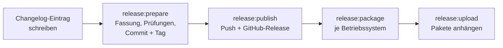

# Veröffentlichung

[Entwicklung](README.md) · [Änderungshistorie](../../internal/changelog/CHANGELOG.md)

Eine Fassung entsteht in vier Schritten. Jeder Schritt ist eine Aufgabe im
[Taskfile](../../Taskfile.yml) und ruft [scripts/release.py](../../scripts/release.py).



## Fassung und Tag

Die Fassung hat drei Stellen, `0.3.0`. Tag und Changelog lassen eine Null an
der letzten Stelle weg: `0.3.0` heißt `v0.3`, `0.3.1` heißt `v0.3.1`.
Fassungen mit führender Null erscheinen auf GitHub als Vorabversion.

Die Programmfassung im Binärprogramm kommt aus `git describe` (siehe
[build/Taskfile.yml](../../build/Taskfile.yml)). Ein Bau auf dem getaggten Commit
trägt deshalb genau `v0.3`, ein Bau mit lokalen Änderungen `v0.3-dirty`.

## Ablauf

1. **Changelog schreiben.** Oben in
   [CHANGELOG.md](../../internal/changelog/CHANGELOG.md) steht ein Eintrag
   `## v0.3 — <Datum>` mit Zusammenfassung und Strichpunkten. Der Text ist
   zugleich der Text der Veröffentlichung. Das Datum setzt der nächste Schritt.
   Den [Umsetzungsstand](../projekt/umsetzungsstand.md) mit abgleichen.

2. **Vorbereiten**, auf einem aktuellen `master` ohne lokale Änderungen:

   ```bash
   task release:prepare -- 0.3.0
   ```

   Das Skript setzt die Fassung in allen Build-Dateien (`build/config.yml`,
   Info.plist, Windows-Manifest, NSIS, MSIX, nfpm), datiert den
   Changelog-Eintrag, führt `task check`, die Frontend-Tests, den
   Frontend-Build und `task test:bridge` aus und legt Commit und Tag lokal an.
   `--skip-bridge` lässt die Bridge-Tests aus, wenn GTK/WebKit fehlen.

3. **Veröffentlichen:**

   ```bash
   task release:publish -- --title "Gründung und Stammdaten"
   ```

   Pusht Branch und Tag und legt mit der [GitHub CLI](https://cli.github.com)
   das Release an. Ohne `gh` gibt das Skript Text und Link für die Anlage von
   Hand aus. `--draft` legt einen Entwurf an.

4. **Pakete bauen und anhängen**, auf jedem Betriebssystem, für das es Pakete
   geben soll:

   ```bash
   task release:package
   task release:upload
   ```

   | System | Aufgabe dahinter | Ergebnis in `dist/` |
   |---|---|---|
   | macOS | `darwin:package:release` | `Buchfink-v0.3-macOS-universal.dmg` und `.zip` |
   | Linux | `linux:package` | AppImage, `.deb`, `.rpm`, Arch-Paket |
   | Windows | `windows:package` | NSIS-Installer |

Den Text einer Fassung zeigt `python3 scripts/release.py notes v0.3`.

## macOS: selbst signierter Build

Apple Silicon startet nur signierte Programme. Ohne weitere Angabe signiert
der Bau ad hoc. Das reicht zum Starten, ändert aber mit jedem Bau die Identität
der App. macOS knüpft Freigaben wie den Zugriff auf Dokumente oder Schreibtisch
an diese Identität und fragt nach jedem Update erneut. Ein selbst ausgestelltes
Zertifikat hält die Identität über Updates stabil.

Keine der beiden Varianten ersetzt eine Developer ID mit Notarisierung:
Gatekeeper blockiert heruntergeladene Pakete trotzdem beim ersten Start.

| | Ad hoc | Selbst signiert | Developer ID + Notarisierung |
|---|---|---|---|
| Startet auf Apple Silicon | ja | ja | ja |
| Identität über Updates stabil | nein | ja | ja |
| Erster Start nach Download | manuell freigeben | manuell freigeben | ohne Rückfrage |
| Kosten | keine | keine | Apple Developer Program |

### Zertifikat einmalig anlegen

1. **Schlüsselbundverwaltung** öffnen, im Menü **Schlüsselbundverwaltung →
   Zertifikatsassistent → Zertifikat erstellen …** wählen.
2. Name `Buchfink Self-Signed`, Identitätstyp **Selbst signierte Root**,
   Zertifikattyp **Codesignatur**. Anlegen im Schlüsselbund „Anmeldung".
3. Prüfen, ob `codesign` die Identität findet:

   ```bash
   security find-identity -p codesigning
   ```

   Ein selbst signiertes Zertifikat steht dort mit dem Hinweis
   `CSSMERR_TP_NOT_TRUSTED` und fehlt bei `-v` ganz. `codesign` signiert
   trotzdem damit. Wer den Hinweis loswerden will, stellt im Zertifikat unter
   **Vertrauen → Codesignierung** auf **Immer vertrauen**.

Zertifikat und privaten Schlüssel als `.p12` sichern. Ein neues Zertifikat
ändert die Identität wieder.

### Bauen und signieren

```bash
export BUCHFINK_SIGN_IDENTITY="Buchfink Self-Signed"
task release:package
```

Ohne Release-Ablauf, etwa zum Ausprobieren:

```bash
task darwin:package:release SIGN_IDENTITY="Buchfink Self-Signed"
codesign --verify --strict --verbose=2 bin/buchfink.app
codesign --display --verbose=2 bin/buchfink.app   # Authority=Buchfink Self-Signed
```

Beim ersten Signieren fragt macOS nach dem Zugriff von `codesign` auf den
Schlüssel; **Immer erlauben** verhindert die Frage bei jedem Bau.

### Erster Start beim Anwender

Nach dem Download setzt macOS das Quarantäne-Attribut, und Gatekeeper weist
die App beim ersten Öffnen ab. Freigeben lässt sie sich so:

1. App nach **Programme** ziehen und einmal öffnen. Die Meldung schließen.
2. **Systemeinstellungen → Datenschutz & Sicherheit**, unten bei der Meldung zu
   Buchfink **Dennoch öffnen** wählen und mit dem Passwort bestätigen.

Im Terminal geht das auch mit
`xattr -dr com.apple.quarantine /Applications/buchfink.app`.

Der Schlüssel der Datenbank liegt im Schlüsselbund. Buchfink greift darauf über
`/usr/bin/security` zu. Die Signatur der App ändert daran nichts.

### Developer ID

Für eine Verteilung ohne manuelle Freigabe braucht es ein Zertifikat „Developer
ID Application" aus dem Apple Developer Program und die Notarisierung. Die
Aufgaben dafür bringt Wails mit (`task darwin:sign:notarize`, Einrichtung mit
`wails3 setup`).
